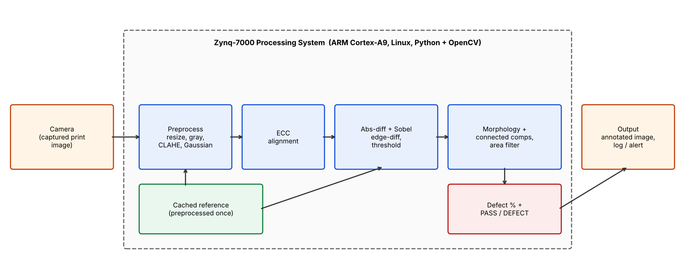

# Live Camera-Based Printing Defect Detection: Normal Reference Capture and Inspection Using the PYNQ-Z2

**Bharat AI-SoC Student Challenge submission**

| | |
|---|---|
| **Author** | Manoj A (NDU202500375) |
| **Programme** | M.Tech - Embedded Systems, NIELIT Calicut |
| **Faculty mentor** | Rajesh M, Scientist E |


## Overview

A lightweight, **training-free** inspection prototype for printed sheets. A defect-free print is captured
as a reference image, and each live USB-camera frame is compared against it. Differences are reported as
candidate defects such as ink spots, missing ink, streaks, blur and ink spreading. No dataset collection
or machine-learning model is required, and when a new print design is introduced only the reference
image is replaced.

The pipeline runs on the **ARM Cortex-A9 Processing System** of the PYNQ-Z2 (Zynq-7000 XC7Z020) under
Linux, using Python and OpenCV at 640 x 480 resolution.

> **Scope note:** this submission is a **CPU-only software baseline**. The FPGA Programmable Logic is not
> used for acceleration here. PL offload using Vitis HLS is planned future work, so FPGA resource, clock
> and power figures are not reported.

## Features

- Live USB-camera acquisition and one-key reference capture
- Illumination normalisation, CLAHE and Gaussian smoothing
- Optional ECC image alignment for small camera or sheet shifts
- Absolute difference with optional Sobel edge comparison
- Otsu thresholding with a minimum noise floor
- Morphological filtering and connected-component analysis
- PASS/DEFECT decision, defect-area percentage, blob count and annotated output
- Per-stage timing for bottleneck analysis

## System architecture



## Processing pipeline

| Stage | Operation |
|---|---|
| 1. Preprocessing | Resize to 640x480, grayscale, illumination normalisation, CLAHE, 5x5 Gaussian blur |
| 2. Alignment (optional) | ECC Euclidean registration at reduced resolution |
| 3. Difference | Absolute difference, optional Sobel edge-difference |
| 4. Thresholding | Otsu threshold with minimum floor (30); edge threshold 60 |
| 5. Morphology | Opening and closing to remove speckle and join fragments |
| 6. Connected components | Label regions, discard components under 30 pixels |
| 7. Decision | Defect % = defect pixels / total pixels x 100; PASS/DEFECT; annotated frame |

## Repository structure

```
.
├── README.md
├── requirements.txt
├── src/
│   ├── defect_detector.py   # core pipeline (CLI + importable module)
│   ├── live_demo.py         # live webcam inspection, reference capture, headless mode
│   ├── benchmark.py         # per-stage latency and configuration comparison
│   └── evaluate.py          # accuracy metrics from a labelled test set
├── dataset/
│   ├── reference/           # normal reference image(s)
│   ├── test_samples/        # test images and labels.csv
│   └── outputs/             # difference maps, masks, annotated results
└── docs/
    ├── Final_Project_Report.pdf
    └── architecture_diagram.png
```

## Getting started

**Requirements:** PYNQ-Z2 (or any Linux machine), USB camera, Python 3.

```bash
pip3 install -r requirements.txt
cd src
```

### Inspect a single image
```bash
python3 defect_detector.py --ref ../dataset/reference/normal_ref.png --test ../dataset/test_samples/<image>.png
```

### Live camera inspection
```bash
# with display: press r = capture reference, s = save frame, q = quit
python3 live_demo.py --source 0

# headless (e.g. over SSH on the board), using a stored reference
python3 live_demo.py --source /dev/video0 --ref ../dataset/reference/normal_ref.png --headless --max-frames 10
```

### Benchmark and evaluation
```bash
python3 benchmark.py --ref ../dataset/reference/normal_ref.png --dir ../dataset/test_samples --repeats 20
python3 evaluate.py  --ref ../dataset/reference/normal_ref.png --dir ../dataset/test_samples --labels ../dataset/test_samples/labels.csv
```

Useful flags: `--no-align`, `--no-edges`, `--no-clahe`.

## Experimental setup

| Item | Setting |
|---|---|
| Board | PYNQ-Z2, Zynq-7000 XC7Z020 |
| Processing engine | ARM Cortex-A9 (Processing System), CPU-only |
| Camera | USB webcam (Logitech C310), 640 x 480 |
| Software | PYNQ Linux, Python 3, OpenCV, NumPy, psutil |
| Blur / CLAHE | 5x5 / enabled |
| Threshold floor / edge threshold | 30 / 60 |
| Minimum component area | 30 pixels |

## Results

### Reference self-test (timing baseline)

The same normal image was used as reference and test input. This confirms end-to-end execution and a
zero-difference result for identical inputs; it is a consistency check, not a defect-detection trial.

| Stage | Time (ms) | Share (%) |
|---|---|---|
| Preprocessing | 84.82 | 15.8 |
| Alignment (ECC) | 276.07 | 51.6 |
| Difference and thresholding | 97.11 | 18.1 |
| Morphological operations | 39.67 | 7.4 |
| Connected components | 28.31 | 5.3 |
| Decision | 2.43 | 0.5 |
| Annotation | 6.79 | 1.3 |
| **Total** | **535.22** | **100.0** |

| Indicator | Value |
|---|---|
| Decision | PASS |
| Candidate defect pixels / blobs | 0.000% / 0 |
| Latency per frame | 535.22 ms |
| Estimated throughput | 1.87 frames/s (1000 / 535.22 ms) |
| Dominant stage | ECC alignment (51.6%) |

### Live-camera observations (preliminary)

| Configuration | Measured output | Interpretation |
|---|---|---|
| Older reference, alignment off | about 45-47% defect pixels, 21-25 blobs, about 293 ms | Large false-positive response; reference and camera mismatch likely |
| Older reference, ECC alignment on | about 29.1-29.4%, 61-65 blobs, about 2.3 s per frame | Alignment lowered the percentage but increased time sharply |
| Newer reference, camera setup changed | about 56%, 18-23 blobs, about 414-484 ms | False positives remained; acquisition stability needs work |

### Hardware utilization

| Metric | Status |
|---|---|
| Latency and stage-wise timing | Measured (tables above) |
| Throughput | 1.87 FPS estimated from self-test latency; not a verified sustained rate |
| Processing engine | ARM Cortex-A9 only |
| FPGA LUT / FF / BRAM / DSP, PL clock, power | Not applicable: no PL accelerator implemented |
| CPU load, RAM | Not measured in the reported runs |
| Precision, recall, F1-score | Not measured: labelled test set still to be built |

**Interpretation:** the pipeline executes correctly on the PYNQ-Z2 PS, and ECC alignment is the main
bottleneck. Live inspection of nominally normal sheets showed substantial false positives caused by camera
pose, paper position and illumination, so this work is a functional proof of concept and not a validated
inspection system.

## Optimization techniques

- Reference preprocessing computed once and cached
- ECC alignment estimated at reduced resolution and scaled back
- Optional alignment, CLAHE and edge-comparison stages
- Small fixed kernels and native OpenCV routines
- Connected-component stage optimised (28.31 ms in the self-test)
- Noise-floor-bounded Otsu threshold with a minimum component area
- Headless operation and per-stage timing for bottleneck analysis

## Limitations

- False positives during live inspection of normal sheets
- Strong dependence on stable camera pose, paper position and lighting
- ECC alignment adds significant latency
- Reports candidate differences only; defect types are not classified
- No labelled accuracy evaluation yet
- Power, PL utilization and PS-PL performance are not measured

## Future work

1. Fixed, perpendicular camera mount with diffuse lighting and locked exposure and white balance
2. Labelled test set of repeated normal frames and intentional defects; report precision, recall and F1
3. Calibrate threshold, morphology and minimum area on that set
4. Offload pixel-parallel stages (grayscale, Gaussian filtering, subtraction, thresholding, morphology)
   to the PL with Vitis HLS, keeping camera control, reference storage and decisions on the PS
5. Compare PS-only and PS+PL execution and report utilization, clock and power

## Author

**Manoj A** - M.Tech Embedded Systems, NIELIT Calicut
Mentor: Rajesh M, Scientist E

## Links
| **Final report** | [Project report (PDF)](https://drive.google.com/file/d/1d6cFktvrbAheTyQMeqEOLJTPhcl8k3EE/view?usp=sharing) |
| **Demo video** | [Watch on Google Drive](https://drive.google.com/file/d/1lnkI1uJAO46rIWgTXDGupA83ac-4KJsg/view?usp=sharing) |

